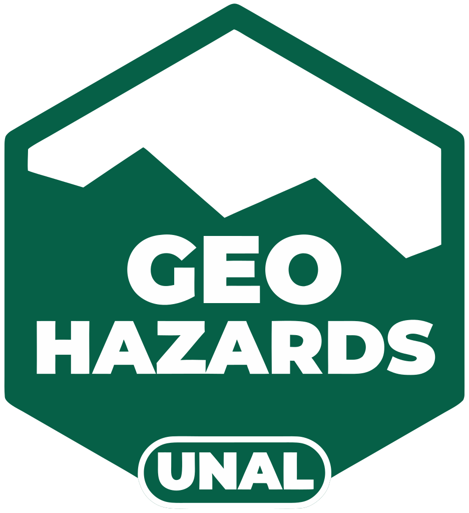

<div align="center">



# GeoHazards — Sitio web

**Semillero de Investigación GEOHAZARDS · Universidad Nacional de Colombia, sede Medellín**

Investigación, monitoreo y apropiación social del conocimiento sobre amenazas geológicas e hidrometeorológicas en Antioquia.

🌐 **[geohazards.com.co](https://geohazards.com.co)**

[](LICENSE)
[](https://geohazards.com.co)
[](https://github.com/geohazards-med/web-page/actions/workflows/actualizar-graficos-lluvia.yml)

</div>

---

## ¿Qué es este repositorio?

Esta rama (`gh-pages`) contiene **el sitio web público de GeoHazards tal como se publica** en [geohazards.com.co](https://geohazards.com.co). Todo lo que hay aquí se sirve directamente con GitHub Pages: no requiere servidor propio ni base de datos.

El sitio reúne:

- 🗺️ **Geovisor** — mapas interactivos con estaciones de monitoreo, perforaciones, aforos, procesos de remoción en masa y capas territoriales.
- 🌧️ **Amenaza por lluvia** — gráficos de lluvia acumulada (90 días) por subregión de Antioquia, **actualizados automáticamente cada día** con datos abiertos del IDEAM.
- 🏘️ **Borde Nororiental de Medellín** — micrositio comunitario del estudio de riesgo en las comunas 1, 3, 8 y el corregimiento de Santa Elena.
- 🎓 **Cursos autoguiados** — formación gratuita en gestión del riesgo y ordenamiento territorial para comunidades.
- 🎤 **V Simposio Geoamenazas 2026** — información del evento.
- 📚 Proyectos, publicaciones y equipo del semillero.

---

## Secciones del sitio

| Sección | Dirección | Descripción |
|---|---|---|
| Inicio | [`/`](https://geohazards.com.co/) | Aplicación principal (proyectos, publicaciones, equipo). |
| Geovisor | [`/geovisor`](https://geohazards.com.co/geovisor) | Visor geográfico con capas de monitoreo y amenaza. |
| Proyectos | [`/projects`](https://geohazards.com.co/projects) | Proyectos de investigación del semillero. |
| Publicaciones | [`/publications`](https://geohazards.com.co/publications) | Artículos y productos académicos. |
| Nosotros | [`/aboutus`](https://geohazards.com.co/aboutus) | Integrantes y colaboradores. |
| Borde Nororiental | [`/comunidad.html`](https://geohazards.com.co/comunidad.html) | Estudio de riesgo participativo: perforaciones, recorridos de campo e hitos por comuna. |
| Curso 1 | [`/curso/`](https://geohazards.com.co/curso/) | *Comprensión del Riesgo* — POT, territorio, construcción del riesgo y herramientas comunitarias. |
| Curso 2 | [`/curso2/`](https://geohazards.com.co/curso2/) | *Planificación y Gestión del Riesgo*. |
| Simposio | [`/simposio.html`](https://geohazards.com.co/simposio.html) | V Simposio Geoamenazas 2026. |

> Las rutas de la aplicación principal (`/geovisor`, `/projects`, …) funcionan gracias a `404.html`, que redirige cualquier ruta al enrutador de la aplicación.

---

## Gráficos de amenaza por lluvia (actualización automática)

Todos los días a las **6:00 a. m. (hora de Colombia)** un flujo de GitHub Actions:

1. Descarga los últimos 90 días de precipitación de estaciones del IDEAM desde el portal [datos.gov.co](https://www.datos.gov.co/resource/s54a-sgyg.json).
2. Ejecuta [`scripts/amenaza/Calculo_Amenaza.py`](scripts/amenaza/Calculo_Amenaza.py), que calcula la lluvia acumulada y la compara con los umbrales de cada subregión.
3. Guarda los gráficos en [`graphs/`](graphs/) y registra el resultado en [`graphs/ultima_corrida.json`](graphs/ultima_corrida.json).
4. Hace *commit* de los cambios en esta rama, y el sitio se actualiza solo.

Subregiones cubiertas: **Bajo Cauca, Nordeste, Norte, Occidente, Oriente y Sureste**.

```
graphs/
├── Bajo cauca_90d.png
├── Nordeste_90d.png
├── Norte_90d.png
├── Occidente_90d.png
├── Oriente_90d.png
├── Sureste_90d.png
└── ultima_corrida.json   ← fecha de ejecución y estado por estación
```

El flujo está en [`.github/workflows/actualizar-graficos-lluvia.yml`](.github/workflows/actualizar-graficos-lluvia.yml) y también puede ejecutarse a mano desde la pestaña **Actions → Run workflow**.

> ⚠️ Los gráficos son un producto académico de apoyo y **no reemplazan las alertas oficiales** del IDEAM, el DAGRAN o las autoridades municipales de gestión del riesgo.

---

## Estructura de la rama

```
.
├── index.html              # Entrada de la aplicación principal (compilada)
├── 404.html                # Redirección de rutas para la aplicación
├── assets/                 # JS/CSS compilados + recursos del micrositio comunitario
├── comunidad.html          # Micrositio Borde Nororiental
├── simposio.html           # V Simposio Geoamenazas 2026
├── curso/                  # Curso 1: Comprensión del Riesgo (audios, videos, PDFs)
├── curso2/                 # Curso 2: Planificación y Gestión del Riesgo
├── data/
│   ├── datos_pagina.js     # Definición de capas del geovisor
│   ├── geodata/            # Capas geográficas (estaciones, cuencas, barrios, comunas…)
│   ├── kobo/               # Datos de formularios de campo (KoboToolbox)
│   ├── forms/              # Plantillas Excel de levantamiento en campo
│   └── documentos/         # Plantillas de inventario
├── graphs/                 # Gráficos de lluvia generados automáticamente
├── scripts/amenaza/        # Script de cálculo de amenaza por lluvia
├── img/ · bg/ · fotos/ · logo/   # Imágenes, fondos, fotos del equipo y logotipo
├── CNAME                   # Dominio personalizado (geohazards.com.co)
├── .nojekyll               # Desactiva Jekyll en GitHub Pages
└── LICENSE                 # Licencia MIT
```

> La aplicación principal (`index.html` + `assets/index-*.js`) es un **build ya compilado**: los nombres de archivo con *hash* cambian en cada despliegue. Para modificarla se edita el código fuente y se vuelve a compilar; no se recomienda editar los archivos de `assets/index-*.js` a mano.

---

## Datos y fuentes

- **IDEAM** — precipitación diaria vía [datos.gov.co](https://www.datos.gov.co/).
- **Servicio Geológico Colombiano (SGC)** — procesos y rasgos de movimientos en masa.
- **Alcaldía de Medellín** — barrios, veredas y comunas (servicios ArcGIS).
- **Levantamientos propios** — estaciones, perforaciones, aforos y puntos críticos registrados con KoboToolbox por el equipo del semillero.

Cada conjunto de datos conserva las condiciones de uso de su fuente original.

---

## Ver el sitio localmente

Como es un sitio estático, basta con servir la carpeta con cualquier servidor HTTP (abrir `index.html` con doble clic no funciona porque usa rutas absolutas y módulos JS):

```bash
git clone -b gh-pages https://github.com/geohazards-med/web-page.git
cd web-page
python -m http.server 8000
# abrir http://localhost:8000
```

Para ejecutar el cálculo de amenaza por lluvia en local:

```bash
pip install -r scripts/amenaza/requirements.txt
AMENAZA_OUTPUT_DIR=graphs python scripts/amenaza/Calculo_Amenaza.py
```

---

## Socios

Este trabajo se desarrolla desde la **Universidad Nacional de Colombia, sede Medellín**, en articulación con la **Alcaldía de Medellín** y **Minciencias**, junto con las comunidades de los territorios estudiados.

## Contacto

¿Preguntas, sugerencias o errores en el sitio? Abre un [*issue*](https://github.com/geohazards-med/web-page/issues) o escríbenos a través del formulario de contacto en [geohazards.com.co](https://geohazards.com.co).

## Licencia

El código de este repositorio se distribuye bajo la [licencia MIT](LICENSE).
© 2021–2026 Semillero de Investigación GEOHAZARDS, Universidad Nacional de Colombia sede Medellín.
